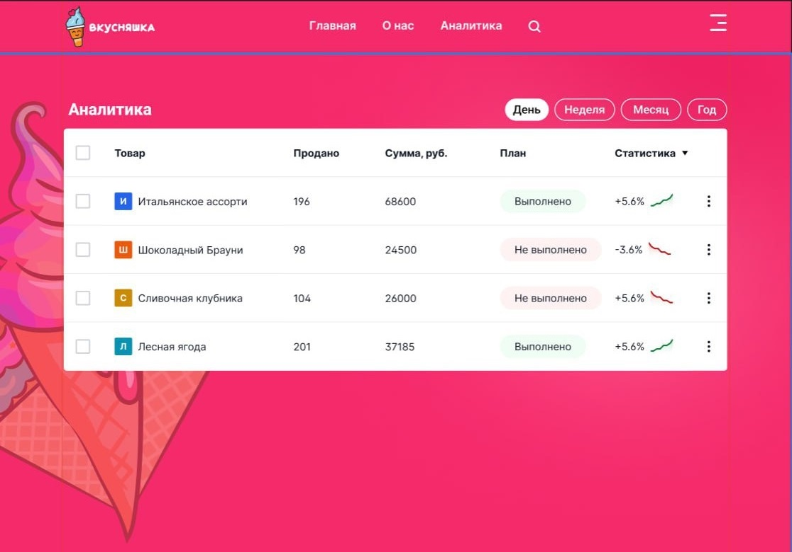

# React + Vite Интернет-магазин мороженого "Вкусняшка"

## Проект SPA (single page application)

### Функционал интернет-магазина

Магазин занимается продажей 4-х видов мороженого

1. Главная страница (/) — навигация по сайту, основной контент, карточки товаров

- В карточке товара доступно изменение количества товара к покупке, добавление в избранное, кнопка купить перемещает товар в корзину
- В навигации растет счетчик при добавлении товара в корзину и в избранное

2. Страница с корзиной (/cart)

- Доступно изменение количества и удаление товара
- После оформления покупки выходит сообщение: "Покупка оформлена! Кол-во шт на сумму ₽`" и идет очистка корзины

3. Страница с избранным (/favorites)

- Удаление товара из избранного

4. Страница с аналитикой (/stats)

- Отражаются данные о покупках по каждому наименованию в штуках / рублях в разрезе День/Неделя/Месяц/Год
- Отслеживается выполнение плана (5 шт/1 вид)
- Выводится общий итог в штуках и деньгах по всем наименованиям
- Кнопка для очистки статистики

5. Страница регистрации/входа (/auth)

- Проверка заполнения всех полей
- Проверка корректного ввода e-mail
- Данные пользователей сохраняются в localStorage

HMR — изменение любого компонента мгновенно отражается в браузере

Адаптив для просмотра:

- Небольшие ноутбуки/планшеты (альбомная ориентация) 767px - 1024px
- Мобильные устройства (портретная ориентация) и планшеты (портретная ориентация) 369px - 767px
- Мобильные устройства - 369px

### Структура проекта  

Vkusnyashka_store /  
├── index.html  
├── package.json  
├── vite.config.js  
├── .gitignore  
└── src /  
&nbsp; ├── main.jsx  
&nbsp; ├── App.jsx  
&nbsp; ├── index.css  
&nbsp; ├── store /  
&nbsp; │ &nbsp; └── store.js  
&nbsp; ├── reducers /  
&nbsp; │ &nbsp; └── productsSlice.js  
&nbsp; ├── utils /  
&nbsp; │ &nbsp; ├── data.js  
&nbsp; │ &nbsp; ├── periods.js  
&nbsp; │ &nbsp; ├── purchases.js  
&nbsp; │ &nbsp; ├── stats.js  
&nbsp; │ &nbsp; └── users.js  
&nbsp; └── components /  
&nbsp; │&nbsp; &nbsp; ├── Content.jsx  
&nbsp; │&nbsp; &nbsp; ├── Navigation.jsx  
&nbsp; │&nbsp; &nbsp; ├── ProductCard.jsx  
&nbsp; │&nbsp; &nbsp; ├── ProductList.jsx  
&nbsp; │&nbsp; &nbsp; └── Notification.jsx  
&nbsp; └── pages /  
&nbsp; │&nbsp; &nbsp; ├── HomePage.jsx  
&nbsp; |&nbsp; &nbsp; ├── CartPage.jsx  
&nbsp; |&nbsp; &nbsp; ├── FavoritesPage.jsx  
&nbsp; |&nbsp; &nbsp; ├── StatsPage.jsx  
&nbsp; |&nbsp; &nbsp; └── AuthPage.jsx  
&nbsp; └── images /  

### Макеты проекта  

  

### QRcode - Visit page on mobile

